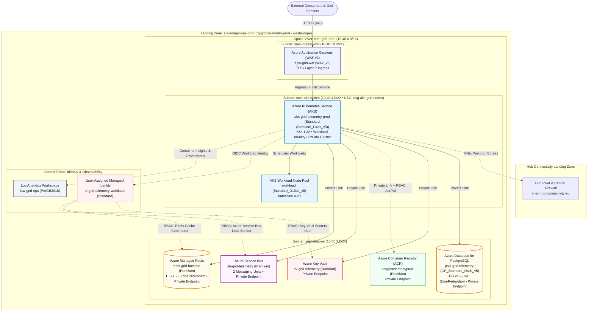
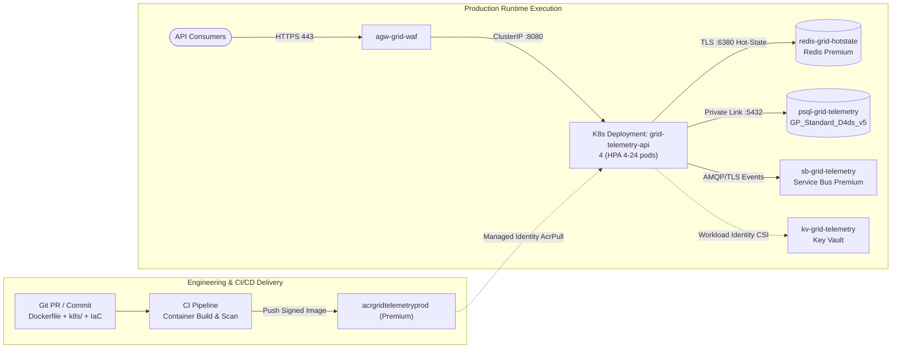

# Grid Telemetry & Dispatch Service — Architecture & Landing Zone Design

> **Centralized Platform Documentation** • Managed sections are synchronized from source IaC via Docs-as-Code PRs; Architectural Decision Records (ADRs) below remain human-curated by @gitpavleenbali.

This guide describes an intended design at the recorded [workload revision](./dac-provenance.json). Diagram paths are not proof of deployment, network reachability, or monitoring. The [workshop topology comparison](https://gitpavleenbali.github.io/dac-workload-modernization/#topology-comparison) separates the VM baseline from the proposed AKS design.

## Executive Topology Summary

<!-- BEGIN DAC:arch-executive-summary source="gitpavleenbali/dac-workload-modernization@c710df3ba7f7faacfcbbacf47fdcb6852238c969" irHash="9d0955415321" -->
| Architecture Dimension | Current State (Synced from Source IaC) |
| :--- | :--- |
| **Product / Service** | **Grid Telemetry & Dispatch Service** (`grid-telemetry-service`) |
| **Landing Zone** | `alz-energy-ops-prod` (`rg-grid-telemetry-prod` in `westeurope`) |
| **Compute Hosting Model** | **Azure Kubernetes Service (Cloud-Native Containers)** |
| **Spoke VNet & Hub Peering** | `vnet-grid-prod` (10.40.0.0/16) peered to `vnet-hub-connectivity-eu` |
| **Ingress Entrypoint** | `agw-grid-waf` (Azure Application Gateway (WAF v2), `WAF_v2`) |
| **Stateful & Messaging Tier** | `psql-grid-telemetry` (GP_Standard_D4ds_v5), `redis-grid-hotstate` (Redis Premium), `sb-grid-telemetry` (Service Bus Premium) |
| **Source Provenance** | `gitpavleenbali/dac-workload-modernization@c710df3ba7f7faacfcbbacf47fdcb6852238c969` • IR Hash `9d0955415321` |
<!-- END DAC:arch-executive-summary -->

## Azure Landing Zone & Network Topology

<!-- BEGIN DAC:arch-topology-diagram source="gitpavleenbali/dac-workload-modernization@c710df3ba7f7faacfcbbacf47fdcb6852238c969" irHash="9d0955415321" -->

<!-- END DAC:arch-topology-diagram -->

## Runtime Traffic & Delivery Architecture

<!-- BEGIN DAC:arch-runtime-diagram source="gitpavleenbali/dac-workload-modernization@c710df3ba7f7faacfcbbacf47fdcb6852238c969" irHash="9d0955415321" -->

<!-- END DAC:arch-runtime-diagram -->

## Virtual Network & Subnet Allocation

<!-- BEGIN DAC:arch-network-table source="gitpavleenbali/dac-workload-modernization@c710df3ba7f7faacfcbbacf47fdcb6852238c969" irHash="9d0955415321" -->
| Subnet Name | CIDR Prefix | Attached NSG | Service Delegation | Hosted / Connected Resources |
| :--- | :--- | :--- | :--- | :--- |
| `snet-aks-nodes` | `10.40.4.0/22` | `nsg-aks-grid-nodes` | `None` | `aks-grid-telemetry-prod`, `workload` |
| `snet-ingress-waf` | `10.40.10.0/24` | `Platform Default` | `None` | `agw-grid-waf` |
| `snet-data-pe` | `10.40.2.0/24` | `Platform Default` | `None` | `acrgridtelemetryprod`, `sb-grid-telemetry`, `redis-grid-hotstate`, `psql-grid-telemetry`, `kv-grid-telemetry` |
<!-- END DAC:arch-network-table -->

## Azure Resource & SKU Inventory

<!-- BEGIN DAC:arch-resource-inventory source="gitpavleenbali/dac-workload-modernization@c710df3ba7f7faacfcbbacf47fdcb6852238c969" irHash="9d0955415321" -->
| Azure Resource Name | Architectural Type | Category | SKU / Sizing | Subnet / Scope | Key Capabilities |
| :--- | :--- | :--- | :--- | :--- | :--- |
| `agw-grid-waf` | Azure Application Gateway (WAF v2) | `ingress` | `WAF_v2` | `snet-ingress-waf` | TLS / Layer-7 Ingress |
| `acrgridtelemetryprod` | Azure Container Registry (ACR) | `containers` | `Premium` | `snet-data-pe` | Private Endpoint |
| `id-grid-telemetry-workload` | User-Assigned Managed Identity | `security` | `Standard` | `rg-grid-telemetry-prod` | Standard |
| `aks-grid-telemetry-prod` | Azure Kubernetes Service (AKS) | `compute` | `Standard (Standard_D4ds_v5)` | `snet-aks-nodes` | K8s 1.32, Workload Identity, Private Cluster, azure (overlay) |
| `workload` | AKS Workload Node Pool | `compute` | `Standard_D16ds_v5` | `snet-aks-nodes` | Autoscale 4-20 |
| `sb-grid-telemetry` | Azure Service Bus | `messaging` | `Premium` | `snet-data-pe` | 2 Messaging Units, Private Endpoint |
| `redis-grid-hotstate` | Azure Managed Redis | `data` | `Premium` | `snet-data-pe` | TLS 1.2, ZoneRedundant, Private Endpoint |
| `psql-grid-telemetry` | Azure Database for PostgreSQL | `data` | `GP_Standard_D4ds_v5` | `snet-data-pe` | PG v16, HA: ZoneRedundant, Private Endpoint |
| `kv-grid-telemetry` | Azure Key Vault | `security` | `standard` | `snet-data-pe` | Private Endpoint |
| `law-grid-ops` | Log Analytics Workspace | `observability` | `PerGB2018` | `rg-grid-telemetry-prod` | Standard |
<!-- END DAC:arch-resource-inventory -->

## Identity, RBAC & Private Connectivity Matrix

<!-- BEGIN DAC:arch-security-rbac source="gitpavleenbali/dac-workload-modernization@c710df3ba7f7faacfcbbacf47fdcb6852238c969" irHash="9d0955415321" -->
| Source Principal / Origin | Target Resource | Access Type | Mechanism / Protocol |
| :--- | :--- | :--- | :--- |
| `aks-grid-telemetry-prod` | `psql-grid-telemetry` | Private Link | `TLS/TCP` |
| `aks-grid-telemetry-prod` | `kv-grid-telemetry` | Private Link | `TLS/TCP` |
| `aks-grid-telemetry-prod` | `acrgridtelemetryprod` | Private Link | `TLS/TCP` |
| `aks-grid-telemetry-prod` | `sb-grid-telemetry` | Private Link | `TLS/TCP` |
| `aks-grid-telemetry-prod` | `redis-grid-hotstate` | Private Link | `TLS/TCP` |
| `aks-grid-telemetry-prod` | `acrgridtelemetryprod` | RBAC: AcrPull | `Entra ID MI` |
| `id-grid-telemetry-workload` | `kv-grid-telemetry` | RBAC: Key Vault Secrets User | `Entra ID MI` |
| `id-grid-telemetry-workload` | `sb-grid-telemetry` | RBAC: Azure Service Bus Data Sender | `Entra ID MI` |
| `id-grid-telemetry-workload` | `redis-grid-hotstate` | RBAC: Redis Cache Contributor | `Entra ID MI` |
| `aks-grid-telemetry-prod` | `workload` | Schedules Workloads | `Kubelet` |
| `External API Consumers` | `agw-grid-waf` | HTTPS (443) | `HTTPS` |
| `agw-grid-waf` | `aks-grid-telemetry-prod` | Ingress -> K8s Service | `HTTP/TLS` |
| `aks-grid-telemetry-prod` | `id-grid-telemetry-workload` | OIDC Workload Identity | `OIDC/IMDS` |
| `aks-grid-telemetry-prod` | `law-grid-ops` | Container Insights & Prometheus | `HTTPS` |
<!-- END DAC:arch-security-rbac -->

## Architectural Decision Records (ADRs) & Design Rationale

### ADR-001: Hub-and-Spoke Network Isolation & Private Endpoints
All stateful data stores (`psql-grid-telemetry`) and secret vaults (`kv-grid-telemetry`) must disallow public network ingress and bind exclusively to `snet-data-pe` via Azure Private Link, with egress inspected through the central Hub Firewall.

### ADR-002: Compute Hosting Posture
The baseline deployment originated on regional Linux Virtual Machines to accelerate initial SCADA/grid sensor migration from on-premises hypervisors. Platform engineering tracks compute density and patching toil quarterly to evaluate containerization.
