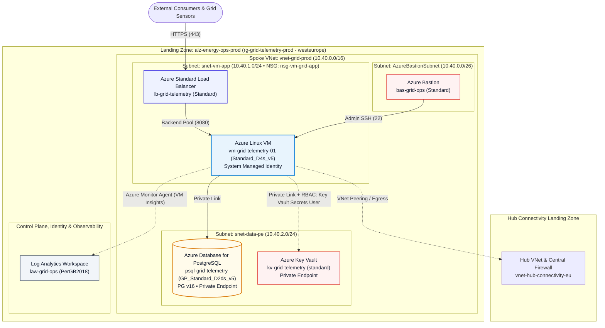
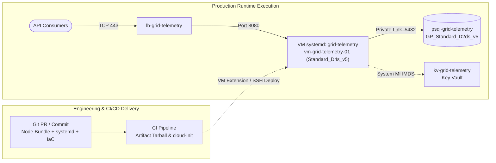

# Grid Telemetry & Dispatch Service — Architecture & Landing Zone Design

> **Centralized Platform Documentation** • Managed sections are synchronized from source IaC via Docs-as-Code PRs; Architectural Decision Records (ADRs) below remain human-curated by @gitpavleenbali.

This guide describes an intended design at the recorded [workload revision](./dac-provenance.json). Diagram paths are not proof of deployment, network reachability, or monitoring. The [workshop topology comparison](https://gitpavleenbali.github.io/dac-workload-modernization/#topology-comparison) separates the VM baseline from the proposed AKS design.

## Executive Topology Summary

<!-- BEGIN DAC:arch-executive-summary source="gitpavleenbali/dac-workload-modernization@9e573d092dd96a87c7ffd631218d41d0717e7261" irHash="e8147f08f46c" -->
| Architecture Dimension | Current State (Synced from Source IaC) |
| :--- | :--- |
| **Product / Service** | **Grid Telemetry & Dispatch Service** (`grid-telemetry-service`) |
| **Landing Zone** | `alz-energy-ops-prod` (`rg-grid-telemetry-prod` in `westeurope`) |
| **Compute Hosting Model** | **Azure Virtual Machines (IaaS)** |
| **Spoke VNet & Hub Peering** | `vnet-grid-prod` (10.40.0.0/16) peered to `vnet-hub-connectivity-eu` |
| **Ingress Entrypoint** | `lb-grid-telemetry` (Azure Standard Load Balancer, `Standard`) |
| **Stateful & Messaging Tier** | `psql-grid-telemetry` (GP_Standard_D2ds_v5) |
| **Source Provenance** | `gitpavleenbali/dac-workload-modernization@9e573d092dd96a87c7ffd631218d41d0717e7261` • IR Hash `e8147f08f46c` |
<!-- END DAC:arch-executive-summary -->

## Azure Landing Zone & Network Topology

<!-- BEGIN DAC:arch-topology-diagram source="gitpavleenbali/dac-workload-modernization@9e573d092dd96a87c7ffd631218d41d0717e7261" irHash="e8147f08f46c" -->

<!-- END DAC:arch-topology-diagram -->

## Runtime Traffic & Delivery Architecture

<!-- BEGIN DAC:arch-runtime-diagram source="gitpavleenbali/dac-workload-modernization@9e573d092dd96a87c7ffd631218d41d0717e7261" irHash="e8147f08f46c" -->

<!-- END DAC:arch-runtime-diagram -->

## Virtual Network & Subnet Allocation

<!-- BEGIN DAC:arch-network-table source="gitpavleenbali/dac-workload-modernization@9e573d092dd96a87c7ffd631218d41d0717e7261" irHash="e8147f08f46c" -->
| Subnet Name | CIDR Prefix | Attached NSG | Service Delegation | Hosted / Connected Resources |
| :--- | :--- | :--- | :--- | :--- |
| `snet-vm-app` | `10.40.1.0/24` | `nsg-vm-grid-app` | `None` | `lb-grid-telemetry`, `vm-grid-telemetry-01` |
| `AzureBastionSubnet` | `10.40.0.0/26` | `Platform Default` | `None` | `bas-grid-ops` |
| `snet-data-pe` | `10.40.2.0/24` | `Platform Default` | `None` | `psql-grid-telemetry`, `kv-grid-telemetry` |
<!-- END DAC:arch-network-table -->

## Azure Resource & SKU Inventory

<!-- BEGIN DAC:arch-resource-inventory source="gitpavleenbali/dac-workload-modernization@9e573d092dd96a87c7ffd631218d41d0717e7261" irHash="e8147f08f46c" -->
| Azure Resource Name | Architectural Type | Category | SKU / Sizing | Subnet / Scope | Key Capabilities |
| :--- | :--- | :--- | :--- | :--- | :--- |
| `bas-grid-ops` | Azure Bastion | `security` | `Standard` | `AzureBastionSubnet` | Standard |
| `lb-grid-telemetry` | Azure Standard Load Balancer | `ingress` | `Standard` | `snet-vm-app` | Standard |
| `vm-grid-telemetry-01` | Azure Linux VM | `compute` | `Standard_D4s_v5` | `snet-vm-app` | System Managed Identity |
| `psql-grid-telemetry` | Azure Database for PostgreSQL | `data` | `GP_Standard_D2ds_v5` | `snet-data-pe` | PG v16, Private Endpoint |
| `kv-grid-telemetry` | Azure Key Vault | `security` | `standard` | `snet-data-pe` | Private Endpoint |
| `law-grid-ops` | Log Analytics Workspace | `observability` | `PerGB2018` | `rg-grid-telemetry-prod` | Standard |
<!-- END DAC:arch-resource-inventory -->

## Identity, RBAC & Private Connectivity Matrix

<!-- BEGIN DAC:arch-security-rbac source="gitpavleenbali/dac-workload-modernization@9e573d092dd96a87c7ffd631218d41d0717e7261" irHash="e8147f08f46c" -->
| Source Principal / Origin | Target Resource | Access Type | Mechanism / Protocol |
| :--- | :--- | :--- | :--- |
| `vm-grid-telemetry-01` | `psql-grid-telemetry` | Private Link | `TLS/TCP` |
| `vm-grid-telemetry-01` | `kv-grid-telemetry` | Private Link | `TLS/TCP` |
| `vm-grid-telemetry-01` | `kv-grid-telemetry` | RBAC: Key Vault Secrets User | `Entra ID MI` |
| `External API Consumers` | `lb-grid-telemetry` | HTTPS (443) | `HTTPS` |
| `lb-grid-telemetry` | `vm-grid-telemetry-01` | Backend Pool (8080) | `HTTP/TLS` |
| `bas-grid-ops` | `vm-grid-telemetry-01` | Admin SSH (22) | `SSH` |
| `vm-grid-telemetry-01` | `law-grid-ops` | Azure Monitor Agent (VM Insights) | `HTTPS` |
<!-- END DAC:arch-security-rbac -->

## Architectural Decision Records (ADRs) & Design Rationale

### ADR-001: Hub-and-Spoke Network Isolation & Private Endpoints
All stateful data stores (`psql-grid-telemetry`) and secret vaults (`kv-grid-telemetry`) must disallow public network ingress and bind exclusively to `snet-data-pe` via Azure Private Link, with egress inspected through the central Hub Firewall.

### ADR-002: Compute Hosting Posture
The baseline deployment originated on regional Linux Virtual Machines to accelerate initial SCADA/grid sensor migration from on-premises hypervisors. Platform engineering tracks compute density and patching toil quarterly to evaluate containerization.
