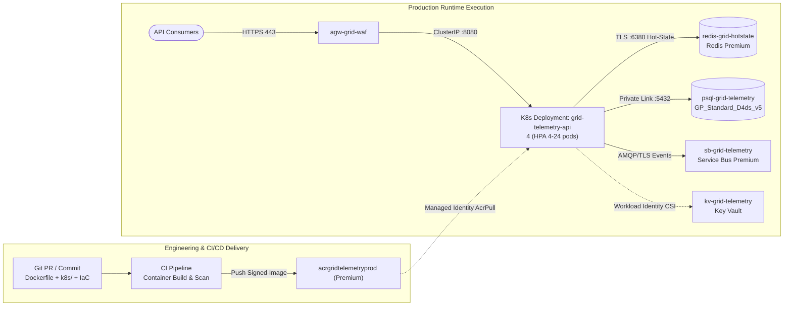

# Grid Telemetry & Dispatch Service — Engineering Contributor Guide

The delivery diagram describes the intended design. This repository's [validation workflow](../../.github/workflows/validate-docs.yml) checks proposed documentation; it does not deploy the app. The [workshop's developer tools section](https://gitpavleenbali.github.io/dac-workload-modernization/#delivery) covers local generation and the opt-in central sync.

## Build, Release & Infrastructure Delivery Flow

<!-- BEGIN DAC:contrib-delivery-flow source="gitpavleenbali/dac-workload-modernization@c710df3ba7f7faacfcbbacf47fdcb6852238c969" irHash="9d0955415321" -->

### Container & AKS Contribution Workflow
1. **Application & OpenAPI Changes:** Update `src/` and `openapi/openapi.yaml`; run `npm test`.
2. **Container Packaging:** CI checks that the Dockerfile builds without pushing an image or deploying the workload. The intended registry is `acrgridtelemetryprod.azurecr.io`.
3. **Kubernetes & IaC Changes:** Update `deploy/k8s/` manifests and `infra/terraform/` (plus `infra/bicep/` mirror). Run `terraform validate`.
4. **Doc as Code Refresh:** In the workload checkout, `npm run dac:render` updates the marked sections and `npm run dac:verify` checks freshness. Central publication is a separate, opt-in GitHub workflow.
<!-- END DAC:contrib-delivery-flow -->

## Repository & Docs-as-Code Contracts

<!-- BEGIN DAC:contrib-repo-contracts source="gitpavleenbali/dac-workload-modernization@c710df3ba7f7faacfcbbacf47fdcb6852238c969" irHash="9d0955415321" -->
| Artifact Path | Responsibility | Consumed By |
| :--- | :--- | :--- |
| `infra/terraform/*.tf` | Primary Azure Landing Zone infrastructure state | Terraform CI + `dac-translator` HCL Extractor |
| `infra/bicep/main.bicep` | Multi-team Bicep reference template | Bicep Validator + `dac-translator` Bicep Extractor |
| `Dockerfile + deploy/k8s/*.yaml` | Workload runtime & scaling specification | Release Pipeline + `dac-translator` Workload Extractor |
| `openapi/openapi.yaml` | REST API contract & health probe endpoints | API Consumers + `user-guide.md` Renderer |
| `dac-manifest.json` | Product ownership & central docs path mapping | `dac-translator` |
<!-- END DAC:contrib-repo-contracts -->

## Code Review Standards, Branching Policy & Definition of Done

- **Review policy:** Route application and infrastructure changes to the listed `CODEOWNERS` reviewers, with passing unit tests and Terraform validation. Enforcement depends on the repository's configured rules.
- **Zero Static Secrets:** Never commit connection strings, SSH keys, or SAS tokens; bind permissions through Managed Identity RBAC in Terraform/Bicep.
- **Documentation Accountability:** Review automated Docs-as-Code PRs alongside architectural changes and append human rationale to `architecture.md` ADRs whenever hosting or stateful services change.
