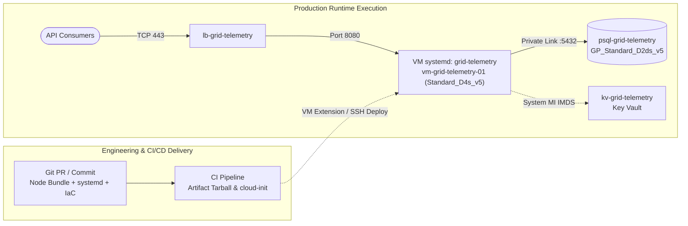

# Grid Telemetry & Dispatch Service — Engineering Contributor Guide

## Build, Release & Infrastructure Delivery Flow

<!-- BEGIN DAC:contrib-delivery-flow source="gitpavleenbali/dac-workload-modernization@70ac7177abe6360d4f1b606913c840111c708fb7" irHash="e8147f08f46c" -->

### Virtual Machine & systemd Contribution Workflow
1. **Application & OpenAPI Changes:** Update `src/` and `openapi/openapi.yaml`; run `npm test`.
2. **VM Packaging:** Update `deploy/systemd/grid-telemetry.service` or `deploy/cloud-init/cloud-init.yaml` when runtime flags change.
3. **IaC Changes:** Update `infra/terraform/` (and `infra/bicep/`); validate with `terraform validate`.
4. **Automated Docs-as-Code Sync:** Run `npx dac-translator verify` locally or allow CI/CD to propose synchronized documentation updates.
<!-- END DAC:contrib-delivery-flow -->

## Repository & Docs-as-Code Contracts

<!-- BEGIN DAC:contrib-repo-contracts source="gitpavleenbali/dac-workload-modernization@70ac7177abe6360d4f1b606913c840111c708fb7" irHash="e8147f08f46c" -->
| Artifact Path | Responsibility | Consumed By |
| :--- | :--- | :--- |
| `infra/terraform/*.tf` | Primary Azure Landing Zone infrastructure state | Terraform CI + `dac-translator` HCL Extractor |
| `infra/bicep/main.bicep` | Multi-team Bicep reference template | Bicep Validator + `dac-translator` Bicep Extractor |
| `deploy/systemd/*.service` | Workload runtime & scaling specification | Release Pipeline + `dac-translator` Workload Extractor |
| `openapi/openapi.yaml` | REST API contract & health probe endpoints | API Consumers + `user-guide.md` Renderer |
| `dac-manifest.json` | Product ownership & Central Docs path mapping | `dac-translator` & GitHub Cloud Agent |
<!-- END DAC:contrib-repo-contracts -->

## Code Review Standards, Branching Policy & Definition of Done

- **Protected `main` Branch:** All application and IaC modifications require pull request approval from `CODEOWNERS`, green unit tests, and passing `terraform validate`.
- **Zero Static Secrets:** Never commit connection strings, SSH keys, or SAS tokens; bind permissions through Managed Identity RBAC in Terraform/Bicep.
- **Documentation Accountability:** Review automated Docs-as-Code PRs alongside architectural changes and append human rationale to `architecture.md` ADRs whenever hosting or stateful services change.
